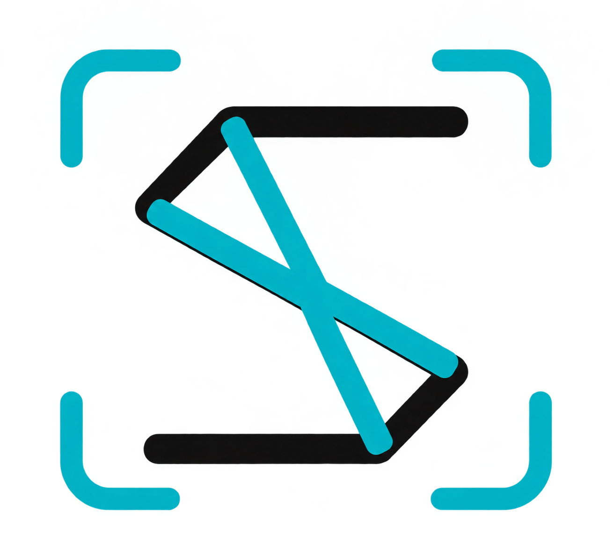
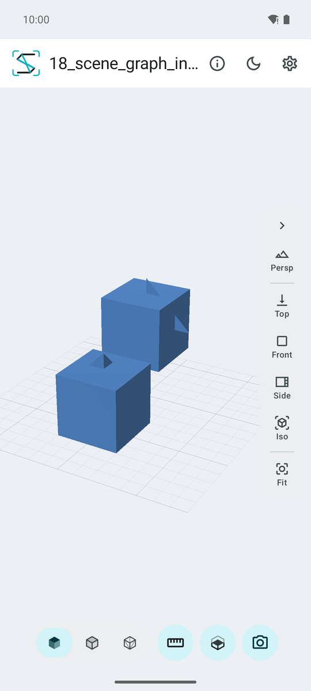
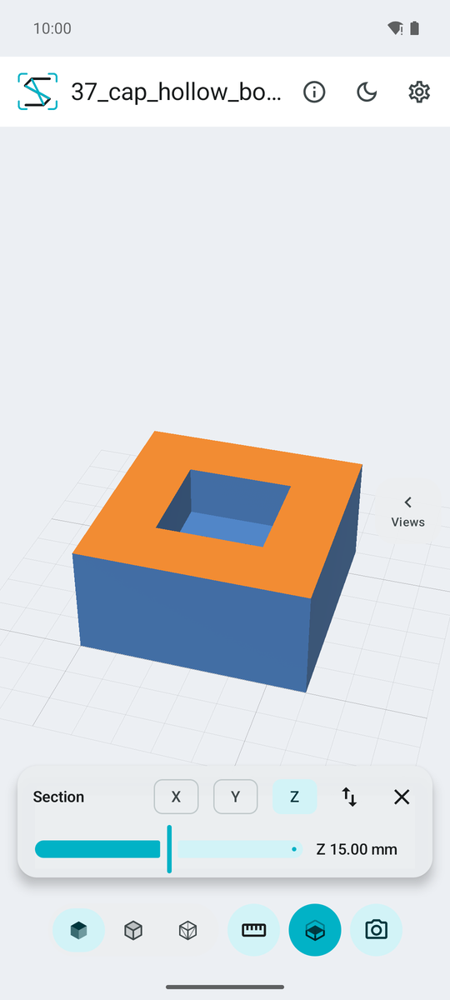
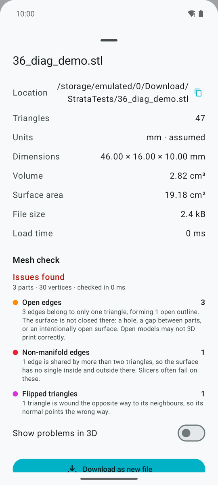
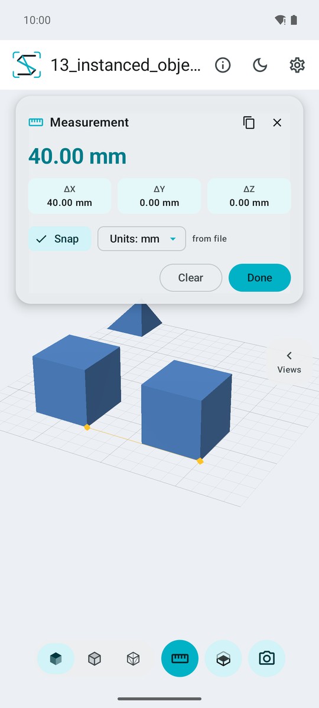

<p align="center">
  
</p>

<h1 align="center">Strata:3D</h1>

<p align="center">
  A fast, lightweight, open-source 3D viewer and scanner for Android.<br>
  Scan real objects into textured 3D models, entirely on your phone.<br>
  No ads, no trackers, no network access.
</p>

<p align="center">
  <a href="https://github.com/damzenquis/Strata-3D/releases/latest"><b>Download the latest APK</b></a>
  · Version 0.9.0 · Android 8.0 or newer · License: AGPL-3.0
</p>

<p align="center">
  
  
  
  
</p>

## Features

- **Seven formats:** binary and ASCII **STL**, **OBJ**, **PLY**, **3MF** (including multi-part slicer projects),
  and **glTF / GLB**. See [docs/FORMATS.md](docs/FORMATS.md) for exactly what is supported.
- **Compressed glTF:** Draco, meshopt and quantized geometry, sparse accessors, and glTFs with separate `.bin`
  files (pick the files together, or open a `.zip`).
- **Fast:** multi-million-triangle models with OpenGL ES 3.0 and 4× MSAA. A 1,000,000-triangle STL parses in
  about 0.1 s on desktop-class hardware.
- **Render modes:** Solid, Solid + edges, and Wireframe, plus **photo colours** for models that come with colour
  images.
- **Touch controls:** drag to orbit, two fingers to pan, pinch to zoom, double-tap to reset.
- **Standard views:** perspective or orthographic, one-tap Top / Front / Side / Iso, and Fit, from a collapsible rail.
- **Portrait and landscape:** a dedicated landscape layout and support for small screens.
- **Measure:** tap two points to get the distance and ΔX/ΔY/ΔZ in millimetres. Snap picks visible vertices near
  your finger. The Units picker sets what a file's coordinates mean (for example inches for an STL).
- **Section:** cut the model along X, Y or Z with a slider, to look inside. Closed models get a filled cut that
  shows wall thickness.
- **Mesh check:** Model info finds open edges, non-manifold edges, flipped, zero-area and inside-out geometry on
  request, and can highlight it in 3D. It never changes the model.
- **Snapshot & Share:** transparent or framed PNGs at Screen, 2× or 4K, shared or saved, with no storage permission.
- **Model info:** triangle count, dimensions, volume, surface area, file size and load time.
- **Opens from anywhere:** the file picker, "Open with…" in file managers, and the Share sheet.
- **Recent Files:** your last models with thumbnails, reopened in one tap, with Reopen when access has lapsed.
- **Light and dark themes,** with a one-tap toggle that is remembered.
- **Scan an object:** tap the object, then walk around it. The smart shutter takes a sharp, full-resolution photo
  each time you've moved far enough and hold the phone steady, with a short buzz when it's time to pause (or press the
  shutter yourself). A coverage dial shows which angles are still missing. Works on any phone with a camera; the smart
  shutter needs a gyroscope.
- **Build the 3D model on the phone:** the photos become a textured model in a few minutes, with no internet: camera
  placement (MVE), dense reconstruction and surface (OpenMVS), and colour from the photos (mvs-texturing). Progress,
  Cancel, and an optional check of the box around the object before building. Needs a 64-bit ARM phone.
- **Real size and export:** give the object's height or width and the model is scaled to it; export it as GLB (colours
  inside, opens at real size) or OBJ (.zip), or export a capture's photos as a `.zip` with COLMAP files.
- **Private by design:** no internet permission, no analytics, no ads. The camera is used only on the capture
  screen, and photos and models stay on the phone unless you share them.
- **Help, Credits and License** are in the settings menu.

## Install

1. Download the latest `Strata-3D-v<version>.apk` from the
   [releases page](https://github.com/damzenquis/Strata-3D/releases/latest).
2. Open it on your phone and allow installing from that source.

Requirements: Android 8.0 (API 26) or newer, with OpenGL ES 3.0. Building 3D models from scans needs a 64-bit ARM phone
(almost every phone from the last several years). Updates install over the previous version.

## Building

See [BUILDING.md](BUILDING.md): the reconstruction tools first, then the app with Gradle.

## Testing

Unit tests cover every parser, the meshopt decoder, the geometry maths, and a generated suite of 35 test models.
The models range from a 2-triangle sparse glTF to a 1,000,000-triangle STL, and every one is checked against
independently computed triangle counts, bounds and surface areas.
See [docs/TESTING.md](docs/TESTING.md) to generate the models and run everything.

## Project layout

```
app/src/main/java/app/strata3d/
  model/    Pure-JVM parsers and decoders (no Android imports, fully unit-testable)
  render/   OpenGL ES 3.0 renderer, camera, picking
  ui/       Jetpack Compose screens, view model, theme
  util/     Android helpers (file locations)
  capture/  Scanning: dataset format, smart shutter and coverage, CameraX camera, on-device reconstruction, screens
tools/      Icon builder, test-model generator, meshopt helpers
tools/recon Build scripts and patches for the on-device reconstruction tools
docs/       Architecture, formats, capture format, testing and release guides
```

[docs/ARCHITECTURE.md](docs/ARCHITECTURE.md) explains how the pieces fit together.

## Roadmap

### 0.9.0 (first public release)
- [x] **Scanning:** CameraX capture with a smart shutter, coverage dial and the object tap; crash-safe storage and
  COLMAP export
- [x] **Build a 3D model on the phone:** MVE, OpenMVS and mvs-texturing run in the app, with progress, Cancel, an
  optional review of the object box, and Open in viewer
- [x] **Real size, photo colours, model export** (GLB / OBJ), and a picture of each model
- [x] **Help, Credits and License** pages
- [x] Verified end to end on the Galaxy A17

### 0.8.0
- [x] **Units:** measurements in real units, from the file's declared unit or your choice per file
- [x] **Cross-section clipping plane:** slice through a model to inspect cavities and wall thickness, with a filled cut
- [x] **Mesh diagnostics:** find non-manifold edges, holes and flipped normals, highlighted in 3D

### 0.7.0
- [x] **Snapshot & Share:** render high-resolution transparent or framed images straight to the Share sheet
- [x] **Standard & Orthographic views:** perspective ↔ orthographic toggle; one-tap Top / Front / Side / Isometric
- [x] **Recent Files:** quick access to recently opened models, with persisted file permissions

### Later
- [ ] **Project management:** organise and revisit sets of models

### Done
- [x] STL, OBJ, PLY, 3MF, glTF/GLB, including Draco, meshopt and quantized glTF
- [x] Measurement tool

## Contributing

Issues and pull requests are welcome. Please read [CONTRIBUTING.md](CONTRIBUTING.md) first. The short version:
keep it lightweight, keep it fast, add tests, and never regress existing behaviour.

## License and credits

Strata:3D is licensed under the [GNU Affero General Public License, version 3 or later](LICENSE)
(AGPL-3.0-or-later). You may use, change and share it, including commercially; if you distribute it, or a
changed version, you must also make the full source available under the same licence.

It began as a fork of [3D Model Viewer](https://github.com/nini1294/3d-model-viewer) by nini1294 (Apache 2.0;
that code keeps its licence, see [third_party/3d-model-viewer-LICENSE.txt](third_party/3d-model-viewer-LICENSE.txt)).
The on-device reconstruction uses MVE and mvs-texturing (BSD-3-Clause) and OpenMVS (AGPL-3.0), with the libraries
listed in the app's third-party notices (Settings › License).
It includes Openize Drako (MIT) and a port of meshoptimizer's reference decoder (MIT).
See [NOTICE](NOTICE) and [third_party/](third_party/) for details.
